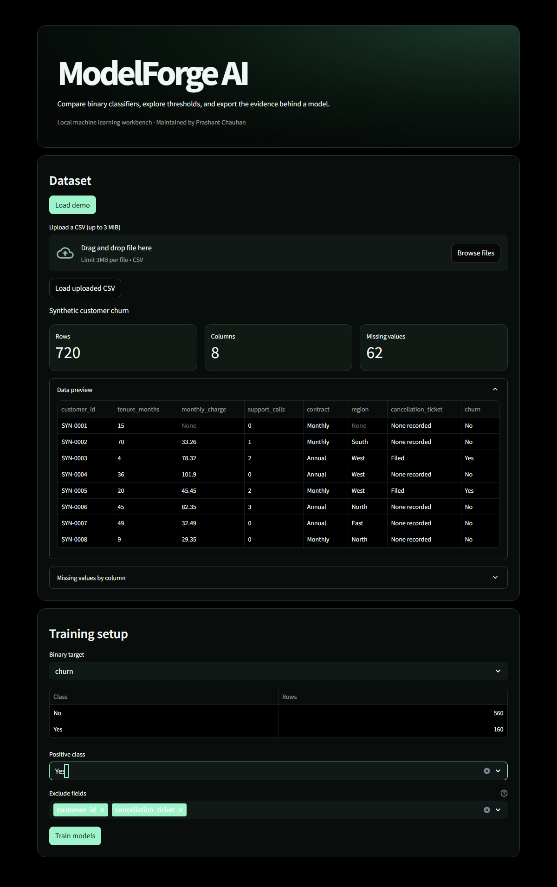
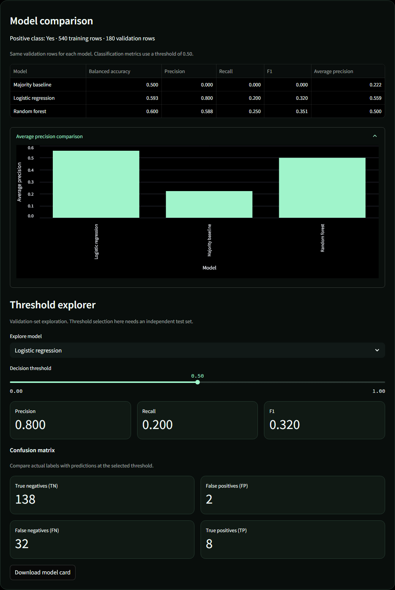

# ModelForge AI

ModelForge AI is a local workbench for binary tabular classification. It helps compare a majority-class baseline with logistic regression and a random forest, explore decision thresholds, and export the configuration and validation evidence behind a result.

**Author and maintainer** [Prashant Chauhan](https://github.com/itsprshnt20)

**Planned repository** [itsprshnt20/ModelForge-AI](https://github.com/itsprshnt20/ModelForge-AI)

## Screenshots

**Synthetic churn dataset and training setup**



**Validation comparison and threshold explorer**



## Features

- Inspect CSV previews, dimensions, missing values, and target class balance.
- Choose the target, explicitly select the positive label, and exclude identifiers or post-outcome features.
- Compare three models on one seeded, stratified validation split.
- Change the selected model's threshold without training again. Export a Markdown model card with the same threshold and metrics.

## Windows setup

Open PowerShell inside the project folder with 64-bit Python 3.11 installed.

```powershell
py -3.11 -m venv .venv
.\.venv\Scripts\python.exe -m pip install -r requirements.txt
.\.venv\Scripts\python.exe -m streamlit run app.py
```

Open [the local dashboard](http://127.0.0.1:8501). The install downloads pinned dependencies from PyPI. The app uses the bundled data at runtime, binds to loopback, and disables Streamlit usage statistics. No API key, hosted service, or database is required.

## Two-minute demo

1. Click **Load demo**. The bundled synthetic churn CSV has **720 rows**, with **160 Yes** and **560 No** labels.
2. In **Training setup**, keep `churn` as the target and select **Yes** as the positive class. Keep `customer_id` and the post-outcome `cancellation_ticket` excluded.
3. Click **Train models**. Compare the three models at threshold **0.50**, then select one under **Threshold explorer**.
4. Move the slider. Lower thresholds mark more rows positive and can increase false positives. Higher thresholds can increase false negatives. Watch the four confusion counts.
5. Click **Download model card**. It records the dataset source, label mapping, selected and excluded columns, training configuration, threshold, metrics, and confusion counts. The export omits raw input rows.

To try the upload path, select `samples/synthetic_churn.csv` and click **Load uploaded CSV**. Set the target, positive class, and exclusions manually.

## Input and training

CSV accepts UTF-8 with or without a BOM, 2–50 distinct column names, up to 20,000 rows, and up to 3 MiB. Blank, NA, N/A, and null fields count as missing. Target labels are trimmed strings. The target must contain exactly two nonmissing classes and both must be represented after the stratified split.

After excluding target and analyst-selected fields, use a **75% training / 25% validation** split with seed **42** and stratification on the binary target. Infer feature types on training rows. A feature is numeric if its nonmissing training values parse as numbers, or if training contains no values for it. Numeric features use median imputation and logistic regression also standardizes them. Unparseable or out-of-range validation values follow the missing-value path. Training numbers outside ±10¹² are rejected. Other features use most-frequent imputation and one-hot encoding with unknown validation categories ignored. Categorical features with more than 100 distinct training values or any value longer than 120 characters must be excluded or prepared before import.

The majority baseline uses `DummyClassifier(strategy="most_frequent")`. The random forest uses 120 trees and a single worker. Every model uses a scikit-learn pipeline fitted on training data. Validation probabilities are held in session memory and reused when the selected model or threshold changes.

```text
Demo CSV / upload → Validation and data preview
                            |
                    Target and exclusions
                            |
                Seeded stratified train/validation split
                            |
                    Training-only pipelines
                            |
                Saved validation probabilities
                            |
          Comparison / threshold explorer / Markdown card
```

## Metrics

| Metric | Meaning |
| --- | --- |
| Balanced accuracy | Mean of positive recall and negative recall. |
| Precision | Share of predicted positives that are actually positive. |
| Recall | Share of actual positives predicted positive. |
| F1 | Harmonic mean of precision and recall. |
| Average precision | Precision averaged at score cutoffs, weighted by recall gains. Uses scores, so changing the display threshold does not alter it. |

Confusion counts use the explicitly selected positive class. A score **equal to** the threshold counts as positive. Undefined precision, recall, or F1 terms use zero. The comparison table uses threshold 0.50 for balanced accuracy, precision, recall, and F1.

### Measured synthetic validation results

These results use 540 training rows and 180 validation rows with Yes as the positive class.

| Model | Balanced accuracy | Precision | Recall | F1 | Average precision |
| --- | ---: | ---: | ---: | ---: | ---: |
| Majority baseline | 0.500 | 0.000 | 0.000 | 0.000 | 0.222 |
| Logistic regression | 0.593 | 0.800 | 0.200 | 0.320 | 0.559 |
| Random forest | 0.600 | 0.588 | 0.250 | 0.351 | 0.500 |

```powershell
.\.venv\Scripts\python.exe workbench.py
.\.venv\Scripts\python.exe samples\generate_churn.py
```

## Tests

```powershell
.\.venv\Scripts\python.exe -m unittest discover -s tests -v
```

Start the app in a separate terminal for the optional browser smoke test. Playwright installs Chromium headless shell and supporting tools.

```powershell
.\.venv\Scripts\python.exe -m pip install playwright==1.65.2
.\.venv\Scripts\python.exe -m playwright install chromium --only-shell
.\.venv\Scripts\python.exe tests/browser_smoke.py
```

## Limitations

- Results describe this synthetic validation split. Thresholds selected on validation data need a separate test set for an independent estimate.
- The app does not identify post-outcome fields, duplicate entities, identifiers encoded as numbers, temporal leakage, or other domain-specific leakage automatically. For repeated entities or time-based use cases, use a suitable group or chronological split outside this workbench.
- Results and uploaded data are session-scoped. The model card is an evaluation record and contains no deployable estimator.
- Categorical features are case-sensitive. Dates and free text do not receive specialized preprocessing.

## GitHub handoff

**Repository description** Local ML workbench for binary classification, with model comparison, threshold tuning, and exportable model cards.

**Resume bullet** Built a local Streamlit classification workbench with three seeded scikit-learn models, cached threshold evaluation, and exportable model cards.

For a new empty GitHub repository, run these commands from the project folder. If a repository already has commits, inspect a clone and preserve its history before adding the audited source.

```powershell
git init -b main
git add -- .gitattributes .gitignore .streamlit LICENSE README.md app.py workbench.py requirements.txt requirements.lock.txt samples docs tests
git diff --cached --check
git commit -m "Build ModelForge AI classification workbench"
git remote add origin https://github.com/itsprshnt20/ModelForge-AI.git
git push -u origin main
```

## License

[MIT](LICENSE) for the original code and synthetic data. Dependencies are installed separately under their upstream licenses. The archive contains no dependency packages.
